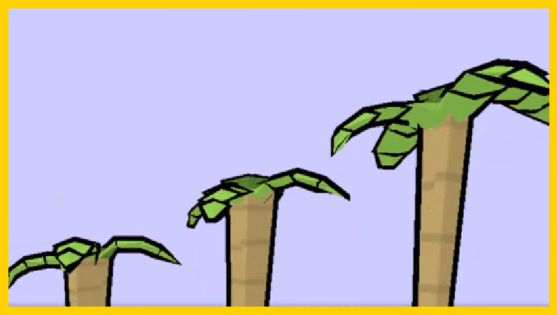

+++
title = "History of Kast"
weight = 100
+++

# The beginning

```
commit f76a18173f481534d2a31207c4db6c798e33ed69
Date:   Jun 26 2024

    Hello world
```

Originally just tried learning OCaml,
and decided to make a simple language as hello world
instead of the usual triangle with OpenGL

# Rewriting it in Rust

```
commit d94317a1bb137c57cbd4e0a81f3cf75a20f679d7
Date:   Sep 20 2024

    Ocaml Deleted, We use Rust now!
```

At some point learning OCaml stopped being the goal.
The goal is now making Kast.
Moved to Rust since I'm much more comfortable with it.

In december, [solved 8 days of Advent of Code](https://github.com/kuviman/aoc2024) with Kast.

# Back to OCaml

```
commit cc375593ade76fcf1ca44fa4ca41b538c4944031
Date:   Jun 21 2025

    Empty project
```

At some point, Rust compile times became too slow.
An incremental debug build took longer than 1 minute
(most of time spent on monomorphization).
Could be solved by refactoring the codebase, using less generics & less async -
but this would be almost rewriting everything from scratch anyway.
Decided to go back to OCaml, even though I like Rust more as a language.
OCaml does compile much faster.

This time I also build language server as part of the compiler,
making everything error resilient,
so we have syntax highlighting, formatting, type info on hover, goto definition, rename, etc.

In december, [solved Advent of Code 2025 fully](https://github.com/kuviman/aoc2025)
using Kast interpreter.

# JavaScript

```
commit ea0fe0cb571860fb601ae8d48d0c5033f78d2ad9
Date:   Dec 30 2025

    hello javascript
```

Kast always needs to have an intepreter,
since its used for comptime evaluation.
So I started with interpreter,
but as a first compilation target I chose JavaScript.

Doing a more low level target would require more work,
and browser always was one of the most important runtime environments.

Supposed to be a temporary solution, like many others in the future.

Jan 21: Built a [simple game example](https://github.com/kuviman/kast-game-example) with js backend
Mar 6: A bit more involved [game](https://github.com/kuviman/d2jam3) for Down2Jam 3 game jam

Performance of transpiled JS was very poor and even such simple game was lagging in the browser.
Even though generating better JS could be done, we start thinking about C transpiling.

# Self Hosting

```
commit b39b555d54bf13ab1842c355c13b2fd7e835608f (self-host)
Date:   Mar 19 2026

    initial commit
```

JavaScript transpiler was enough to start working on self-hosting
After implementing Lexer & Parser,
an idea of an intermediate language came to mind.

# MiniKast

```
commit 69cf3cceaf24ac8b49092f5107a00ca0500e9e85
Date:   Apr 2 2026

    the birth of minikast
```

[MiniKast](/docs/mini) was supposed to be a simple middle language,
which I would transpile into from Kast,
and then transpile from MiniKast to C.

It took a bit over 2 weeks to have it working good enough
to make a game with MiniKast for LudumDare -
transpiling to C + Raylib + Emscripten:

[MegaHonk](https://github.com/kuviman/megahonk)
```
commit 0c7a66ebf7fc7ba32c9272a8e0dbef910578b9d8
Date:   Apr 18 2026
```

# Transpiling to C

```
commit b30f21fd3ea47cef811dafa2b119cfd481377367
Date:   15 2026

    wip transpiler to c
```

Once transpiling to MiniKast was starting,
I realized its just easier to go directly to C instead,
so we start implementing C transpiler in bootstrap OCaml version.

Since a bunch of code was written using JS transpiler,
the initial C code was using garbage collection
with [boehmgc](https://github.com/bdwgc/bdwgc).

Sep 11: Made [Scale to Space](https://github.com/kuviman/scale-to-space) for Down2Jam 4



C transpiler was performing much better than JS but this game still
needed improvements, especially in browsers.

The way GC worked originally is every single variable was GC'd,
plus all structs were boxed to mimic JS.

Adding unboxed structs & doing very simple escape analysis on transpiled C code
made game perform really well.

# RAII

```
commit f4de3e194eab9d085cd9013b7f9c21c000dc72ba
Date:   Oct 8 2026

    progress towards no gc
```

But GC was never the goal, I want to have proper
systems programming language,
so next step was removing GC in favor of RAII.

Once again, a temporary solution is still present -
move semantics are non-destructive, similar to C++,
leading to more destructor invocations than necessary,
but it works for C++ so it shouldn't be a big deal.
Later I plan for destructive Rust-like move semantics &
borrow checker.

# Here we are

to be continued